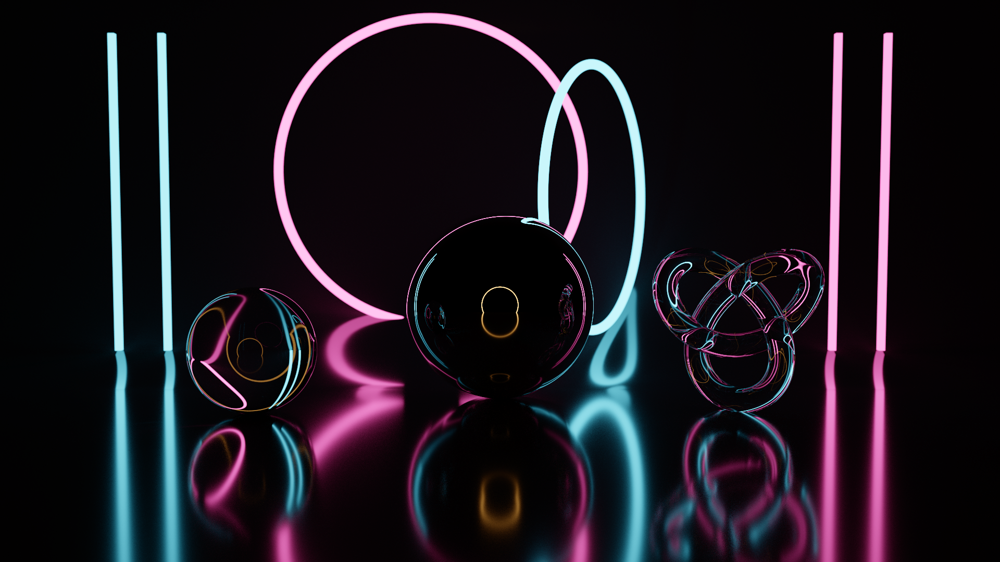
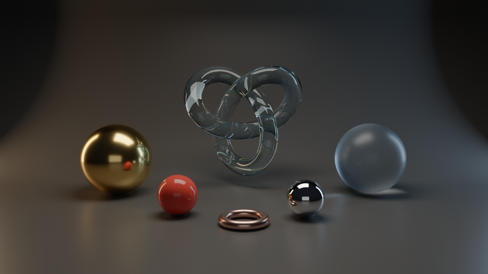
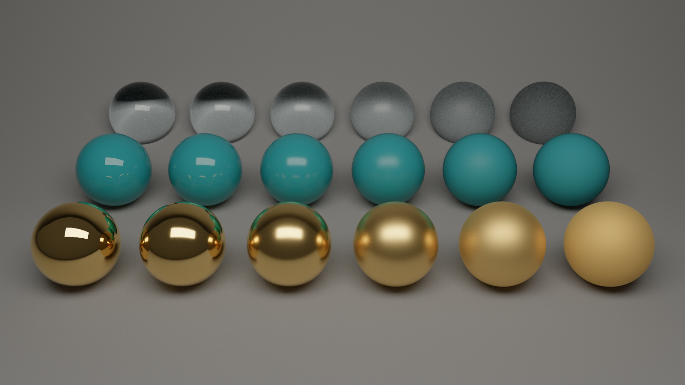
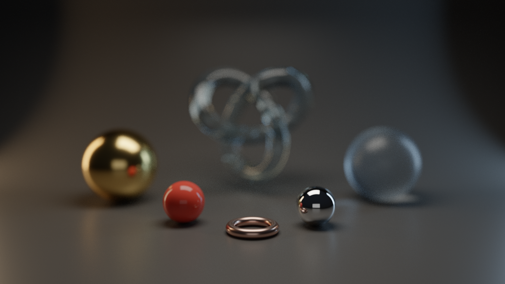
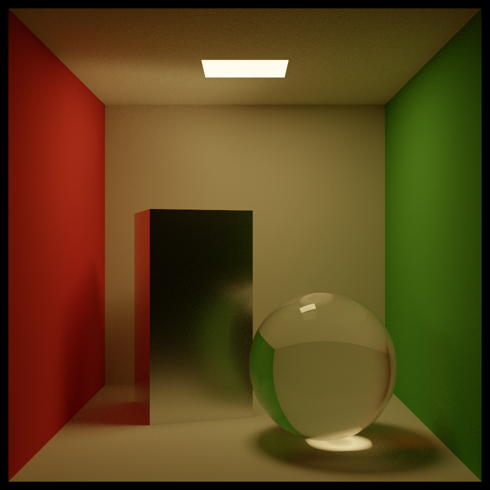

# Caustic

A progressive GPU path tracer for Apple silicon, written in C++20 and Metal.



Caustic renders physically based images by tracing light paths on the GPU. The image refines progressively and the camera can be moved freely while it does. Everything is implemented from scratch on top of [metal-cpp](https://developer.apple.com/metal/cpp/); no rendering or ray tracing libraries are used.

## Gallery

| | |
|:--:|:--:|
|  |  |
| Studio scene | Material chart: glass, plastic and gold at increasing roughness |
|  |  |
| Depth of field with a 6-blade aperture | Cornell box with a glass sphere |

## Features

- **Path tracing on the GPU.** Unidirectional path tracing in a Metal compute kernel, with next-event estimation and multiple importance sampling.
- **Custom BVH.** Built on the CPU with the surface area heuristic and traversed on the GPU with a stack-based kernel.
- **Physically based materials.** Lambertian diffuse, GGX metals, rough and smooth glass with absorption, and coated plastic. Rough metals use multiple-scattering energy compensation, so they don't darken at high roughness.
- **Thin-lens camera.** Depth of field with circular or polygonal (5, 6 or 8 blade) apertures, plus click-to-focus.
- **AgX tonemapping.** Filmic highlight roll-off.
- **OBJ import.** Load your own models into the studio scene.
- **Interactive and offline modes.** Explore scenes in a window, or render stills to PNG from the command line.
- **No Xcode required.** Shaders are embedded in the binary and compiled at launch.

## Building

Requirements: a Mac with Apple silicon and the Xcode Command Line Tools (`xcode-select --install`).

```bash
make
```

## Usage

Open the interactive viewer:

```bash
./build/caustic --scene neon
```

Render an image to a file:

```bash
./build/caustic --scene studio --output studio.png --size 1920x1080 --spp 2048
```

| Option | Description |
|---|---|
| `--scene NAME` | `studio`, `neon`, `materials` or `cornell` |
| `--obj FILE` | Place an OBJ model in the studio scene |
| `--aperture R`, `--focus D` | Override the lens radius and focus distance |
| `--output FILE` | Render to a PNG instead of opening a window |
| `--size WxH`, `--spp N` | Output resolution and samples per pixel |

`make renders` regenerates the images in this README.

### Controls

| Input | Action |
|---|---|
| Drag | Orbit |
| Option-drag | Pan |
| Scroll / pinch | Zoom |
| Click | Focus on the clicked point |
| `[` `]` | Decrease / increase aperture |
| `B` | Cycle aperture shape |
| `-` `=` | Decrease / increase exposure |
| `1`–`4` | Switch scene |
| `P` | Save the current image as PNG |
| `R` | Reset camera |
| `H` | Toggle overlay |

## Project structure

```
src/
├── main.mm               application window, input and command line
├── renderer.cpp/hpp      Metal setup and render passes
├── scene.cpp/hpp         meshes, materials, BVH construction, OBJ loading
├── scenes.cpp            built-in scenes
└── shaders/
    ├── pathtracer.metal  path tracing kernel
    ├── display.metal     tonemapping and presentation
    └── shared.h          data structures shared by C++ and Metal
```

Each frame adds one or more samples per pixel to an accumulation buffer, then tonemaps the average for display. While the camera is moving the renderer traces one sample per frame; once it stops, the number of samples per frame is adjusted to fill the frame time.

## Performance and limitations

On a base M1, Caustic traces 12–20 million paths per second, which is roughly 15–20 fps at 1280×800 during camera movement.

- Very rough glass loses some energy, because rough dielectrics use a single-scattering model.
- Caustics from small light sources converge slowly, which is inherent to unidirectional path tracing.
- Textures and denoising are not yet supported.

## License

Apache 2.0. metal-cpp, in `third-party/`, is © Apple Inc. and distributed under its own Apache 2.0 license.
